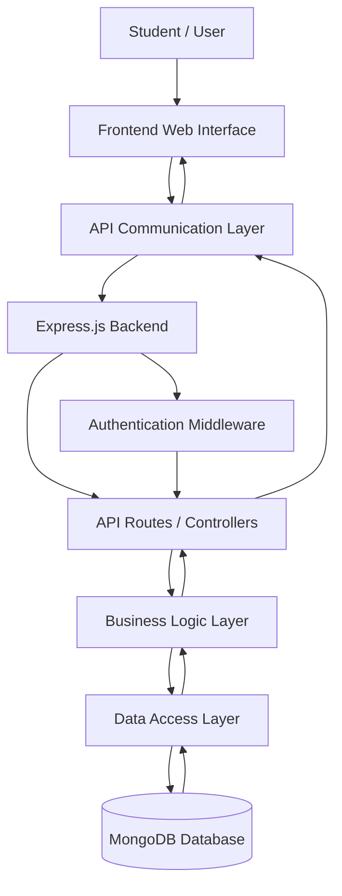
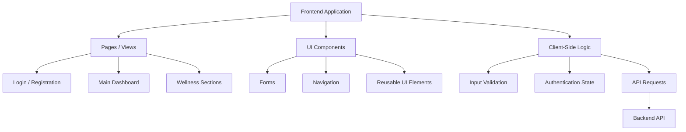
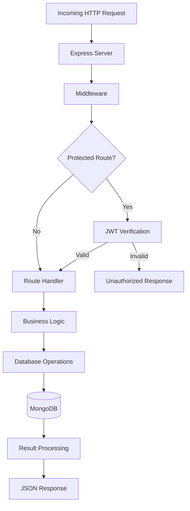
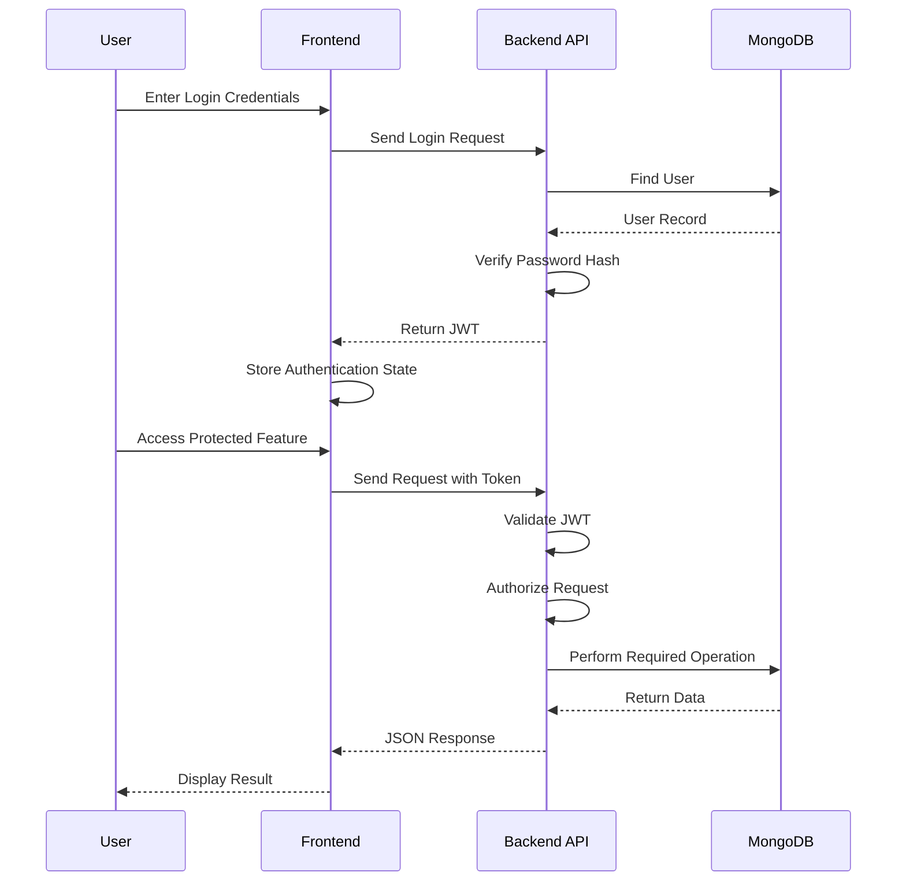
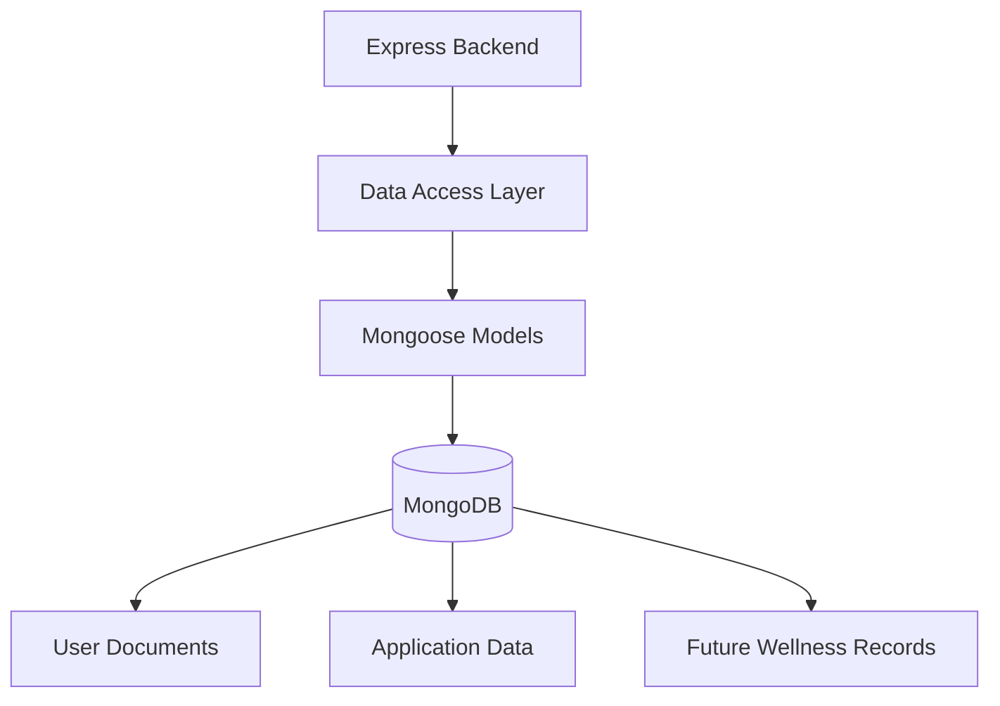
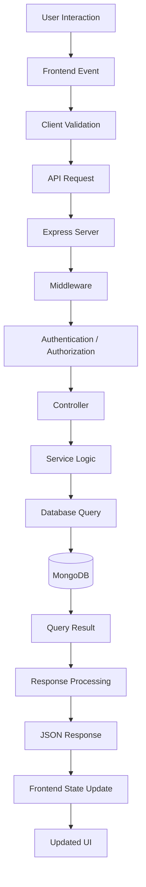
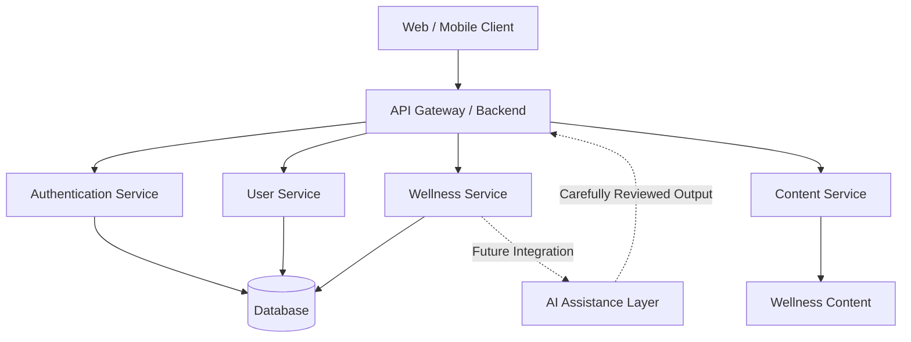

# 🧠 SoulHeal — Student Mental Wellness Platform

<p align="center">
  <b>A digital platform designed to support student mental wellness, encourage self-reflection, and make emotional well-being resources more accessible.</b>
</p>

<p align="center">
  
  
  
  
  
</p>

---

## 📖 Overview

**SoulHeal** is a student-focused mental wellness platform designed to provide a digital space where students can engage with mental wellness resources, reflect on their emotional well-being, and access supportive tools.

Academic pressure, deadlines, social challenges, and everyday responsibilities can affect a student's emotional well-being. SoulHeal aims to make mental wellness support more accessible through a simple, user-friendly web application that combines technology with a wellness-oriented experience.

The application follows a client-server architecture, separating the frontend interface, backend application logic, authentication mechanisms, and database operations to create a modular and maintainable system.

> SoulHeal is a wellness-support platform, not a substitute for professional mental health care, diagnosis, or emergency assistance.

---

## 🎯 Problem Statement

Students may experience stress, emotional exhaustion, academic pressure, and difficulties maintaining a healthy balance between academics and personal life.

However, accessing support, maintaining self-awareness, and finding appropriate wellness resources are not always convenient.

SoulHeal aims to address this by providing a centralized digital platform that focuses on:

- Encouraging emotional self-awareness.
- Making wellness resources easier to access.
- Providing a user-friendly digital wellness experience.
- Offering a structured platform for student wellness activities.
- Creating a foundation for future personalized wellness features.

---

## ✨ Key Features

### 👤 User Management & Authentication
- User registration and login.
- Secure password handling.
- Authentication using JSON Web Tokens (JWT).
- Protected access to authenticated functionality.

### 🌿 Mental Wellness Experience
- Student-oriented wellness interface.
- A centralized environment for wellness-related activities.
- Supportive and accessible user experience.

### 📊 Personalized Platform
- User-specific application experience.
- Foundation for personalized wellness content.
- Extensible structure for future user preferences and progress tracking.

### 🔐 Security-Oriented Backend
- Password hashing using bcrypt.
- Token-based authentication.
- Backend validation of protected requests.
- Separation of client and server responsibilities.

### 🧩 Modular Architecture
- Independent frontend and backend components.
- Reusable backend routes and middleware.
- Database abstraction through application logic.
- Easier maintenance and future expansion.

---

## 🛠️ Tech Stack

| Technology | Purpose |
|---|---|
| HTML | Webpage structure |
| CSS | UI styling and layout |
| JavaScript | Client-side functionality |
| Node.js | Backend runtime |
| Express.js | Backend framework and API routing |
| MongoDB | Database |
| Mongoose | MongoDB object modeling |
| bcrypt / bcryptjs | Password hashing |
| JSON Web Token (JWT) | Authentication and session token validation |
| dotenv | Environment configuration |
| Git & GitHub | Version control and collaboration |

---

# 🏗️ Complete System Architecture

SoulHeal follows a **layered client-server architecture**. Each layer has a dedicated responsibility, allowing the application to remain organized, scalable, and easier to maintain.

## 1. High-Level Architecture



### Architecture Components

| Layer | Responsibility |
|---|---|
| Presentation Layer | Displays webpages, forms, navigation, and user interactions |
| API Communication Layer | Sends requests from the frontend to the backend |
| Routing Layer | Receives requests and directs them to appropriate endpoints |
| Authentication Layer | Validates JWT tokens and restricts protected resources |
| Business Logic Layer | Processes application operations and rules |
| Data Access Layer | Handles database operations |
| Database Layer | Stores application data persistently |

---

## 2. Frontend Architecture

The frontend is responsible for providing the user-facing experience of SoulHeal.

It handles the interface, user interactions, input collection, navigation, and communication with the backend.



### Frontend Responsibilities

- Display the application interface.
- Collect and validate user input.
- Handle navigation between sections.
- Manage login-related client state.
- Communicate with backend API endpoints.
- Display success, error, and loading states.
- Render user-specific information returned by the backend.

The frontend should not directly access the database. All data operations are performed through backend API requests.

---

## 3. Backend Architecture

The backend acts as the central processing layer of SoulHeal.

It receives client requests, validates them, executes application logic, interacts with the database, and returns structured responses.



### Backend Responsibilities

- Handle HTTP requests and responses.
- Define API endpoints.
- Authenticate users.
- Validate authorization.
- Hash and verify passwords.
- Process application logic.
- Interact with MongoDB.
- Handle exceptions and errors.
- Return appropriate HTTP status codes and JSON responses.

### Backend Components

| Component | Responsibility |
|---|---|
| Server | Initializes the Express application |
| Routes | Defines API endpoints |
| Controllers | Handles request and response logic |
| Middleware | Authentication, validation, and request processing |
| Models | Defines database schemas |
| Services | Contains reusable business logic |
| Configuration | Manages environment variables and system configuration |

---

## 4. Authentication Architecture

SoulHeal uses a token-based authentication approach using JSON Web Tokens (JWT).

Authentication allows the backend to identify authenticated users and control access to protected routes.

### Authentication Flow



### Authentication Steps

1. The user submits login credentials.
2. The frontend sends the credentials to the backend.
3. The backend searches for the user in MongoDB.
4. The submitted password is verified against the stored password hash.
5. If the credentials are valid, the backend generates a JWT.
6. The frontend uses the authentication token when requesting protected resources.
7. Authentication middleware validates the token.
8. Authorized requests continue to the corresponding route handler.

### Security Components

- Password hashing using bcrypt.
- JWT-based authentication.
- Protected backend routes.
- Server-side authentication checks.
- Environment-based configuration.
- Validation of incoming requests.

---

## 5. Database Architecture

SoulHeal uses MongoDB as its database, allowing application records to be stored as flexible JSON-like documents.

The backend communicates with MongoDB through the data-access layer using Mongoose models.



### Database Responsibilities

- Persist user account information.
- Store application-related records.
- Retrieve information for authenticated users.
- Support future user-specific wellness functionality.

### User Data Model — Conceptual

The user collection may contain fields such as:

| Field | Description |
|---|---|
| `_id` | Unique MongoDB identifier |
| `name` | User's display name |
| `email` | Unique user email |
| `password` | Securely hashed password |
| `createdAt` | Account creation timestamp |
| `updatedAt` | Last record update timestamp |

<sub>The table describes a conceptual account model. Actual schema fields should be verified against the implementation.</sub>

---

# 🔄 Complete Request Lifecycle

When a user performs an action on SoulHeal, the request travels through multiple layers.



### Request Processing

1. The user interacts with a frontend element.
2. The frontend validates the input.
3. A request is sent to the backend.
4. Express receives the request.
5. Middleware performs required checks.
6. The route invokes the appropriate controller.
7. Business logic processes the request.
8. The data-access layer communicates with MongoDB.
9. MongoDB returns the requested result.
10. The backend generates a response.
11. The frontend receives the response and updates the interface.

---

# 📁 Project Structure

The application is organized into frontend and backend sections to maintain separation of concerns.

```text
SoulHeal/
│
├── frontend/
│   ├── public/
│   │   └── Static Assets
│   │
│   ├── src/
│   │   ├── components/
│   │   │   └── Reusable UI Components
│   │   │
│   │   ├── pages/
│   │   │   └── Application Pages
│   │   │
│   │   ├── styles/
│   │   │   └── Styling Files
│   │   │
│   │   ├── services/
│   │   │   └── API Communication
│   │   │
│   │   └── App.js
│   │
│   └── package.json
│
├── backend/
│   ├── config/
│   │   └── Configuration & Database Connection
│   │
│   ├── controllers/
│   │   └── Request Handlers
│   │
│   ├── middleware/
│   │   └── Authentication & Validation
│   │
│   ├── models/
│   │   └── MongoDB Schemas
│   │
│   ├── routes/
│   │   └── API Routes
│   │
│   ├── services/
│   │   └── Business Logic
│   │
│   ├── utils/
│   │   └── Utility Functions
│   │
│   ├── server.js
│   └── package.json
│
├── .gitignore
└── README.md
```

> The directory tree above represents the recommended logical architecture. Adjust names and paths to match the actual repository folders.

---

# 🔌 API Architecture

The backend exposes REST-style API endpoints through Express.

Requests and responses are exchanged in JSON format, enabling the frontend to communicate with the backend independently of its implementation.

### API Request Format

```json
{
  "email": "user@example.com",
  "password": "your_password"
}
```

### API Response Format — Example

```json
{
  "success": true,
  "message": "Request completed successfully",
  "data": {}
}
```

### API Responsibilities

- Authentication requests.
- Account-related operations.
- Protected user requests.
- Data retrieval and modification.
- Error and validation responses.

> Actual endpoint paths and payloads depend on the backend route implementation.

---

# 🔐 Security & Privacy

SoulHeal is designed around the importance of privacy and secure handling of user information.

Security practices used or intended within the application include:

- **Password Hashing:** Passwords are hashed before storage rather than stored as plaintext.
- **JWT Authentication:** Tokens are used to verify authenticated requests.
- **Protected Routes:** Restricted endpoints require authentication.
- **Environment Variables:** Credentials and secrets are kept outside source code.
- **Input Validation:** Incoming requests should be validated before processing.
- **Database Separation:** The frontend cannot directly access database credentials or perform database operations.

Since this is a mental wellness-oriented platform, sensitive personal information should be collected only when necessary and handled with appropriate privacy safeguards.

---

# ⚙️ Installation & Setup

Follow these steps to run SoulHeal locally.

## Prerequisites

Install the following:

- Node.js
- npm
- MongoDB — local installation or a MongoDB Atlas database
- Git
- Visual Studio Code (recommended)

---

## 1. Clone the Repository

```bash
git clone https://github.com/Sabyasachi100/SoulHeal.git
```

Navigate into the project:

```bash
cd SoulHeal
```

---

## 2. Install Backend Dependencies

Navigate to the backend directory:

```bash
cd backend
```

Install dependencies:

```bash
npm install
```

---

## 3. Configure Environment Variables

Create a `.env` file inside the backend directory.

```env
PORT=5000
MONGODB_URI=your_mongodb_connection_string
JWT_SECRET=your_secure_secret_key
```

Replace the placeholder values with your own local configuration.

Never commit the `.env` file to GitHub.

---

## 4. Start the Backend

```bash
npm start
```

If the project uses a development script instead:

```bash
npm run dev
```

The backend should start on the configured port.

Example:

```text
http://localhost:5000
```

---

## 5. Start the Frontend

Open a second terminal and navigate to the frontend folder:

```bash
cd frontend
```

Install the frontend dependencies:

```bash
npm install
```

Start the frontend:

```bash
npm run dev
```

Open the frontend URL displayed in the terminal.

> If the frontend uses a different framework or startup command, follow the scripts defined in its `package.json`.

---

# 🧪 Testing

The application can be tested across the following areas:

- User registration.
- Login with valid and invalid credentials.
- Password verification.
- Authentication token validation.
- Access to protected routes.
- Frontend form validation.
- API response handling.
- Database connectivity.
- Error handling for invalid requests.

Future development can introduce automated unit tests, integration tests, and end-to-end tests.

---

# 📈 Scalability & Future Architecture

SoulHeal is structured with the potential to expand beyond its initial implementation.

### Planned Improvements

- 📊 Wellness progress and activity dashboard.
- 📅 Personal journaling and reflection.
- 🌱 Personalized wellness recommendations.
- 💬 Supportive conversational interface.
- 🧠 Integration of carefully evaluated AI wellness features.
- 📱 Responsive mobile-first experience.
- 🔔 Reminder and notification system.
- 🧑‍⚕️ Links to qualified professional support.
- 📉 Analytics for aggregated, privacy-preserving usage insights.
- 🧪 Automated backend and frontend testing.
- ☁️ Production deployment and CI/CD pipeline.

### Potential Future Architecture



<sub>This diagram represents a possible future architecture and not necessarily the current deployed implementation.</sub>

---

# 📚 Learning Outcomes

Developing SoulHeal provides practical experience with:

- Full-stack web application development.
- Client-server architecture.
- REST API design.
- Authentication and authorization.
- JWT implementation.
- Password hashing.
- Database integration using MongoDB.
- Backend modularization.
- Environment configuration.
- Application security.
- Real-world problem-solving through software.

---

# 🤝 Contributing

Contributions, suggestions, bug reports, and improvements are welcome.

1. Fork the repository.
2. Create a new branch.
3. Make your changes.
4. Test the functionality.
5. Submit a pull request.

---

# 👨‍💻 Developer

**Sabyasachi Mishra**

B.Tech Computer Science & Engineering  
Interested in Artificial Intelligence, Machine Learning, Full-Stack Development, and Software Engineering.

- GitHub: [@Sabyasachi100](https://github.com/Sabyasachi100)

---

<p align="center">
  <b>Building technology that supports people — one step at a time. 🌱</b>
</p>

<p align="center">
  ⭐ If you find this project interesting, consider starring the repository.
</p>
